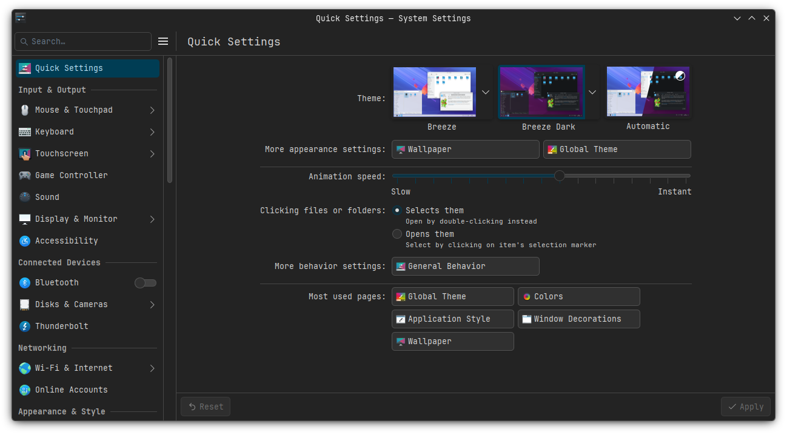
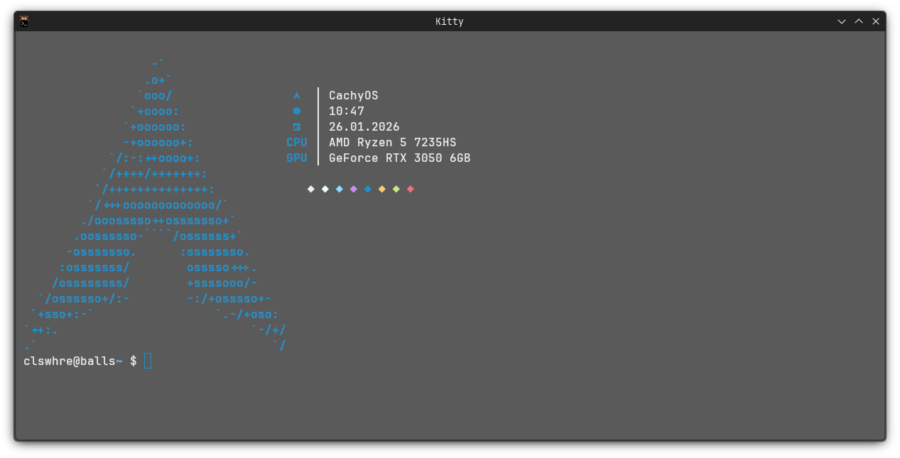
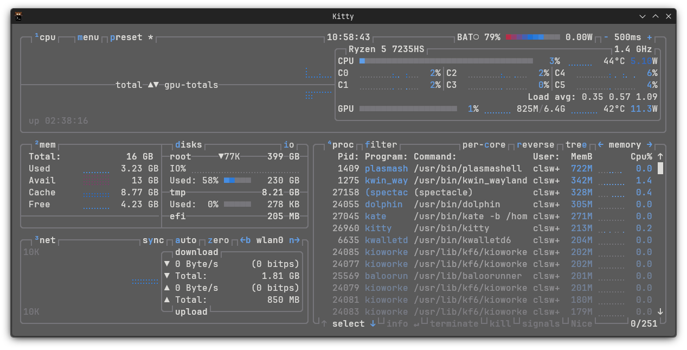
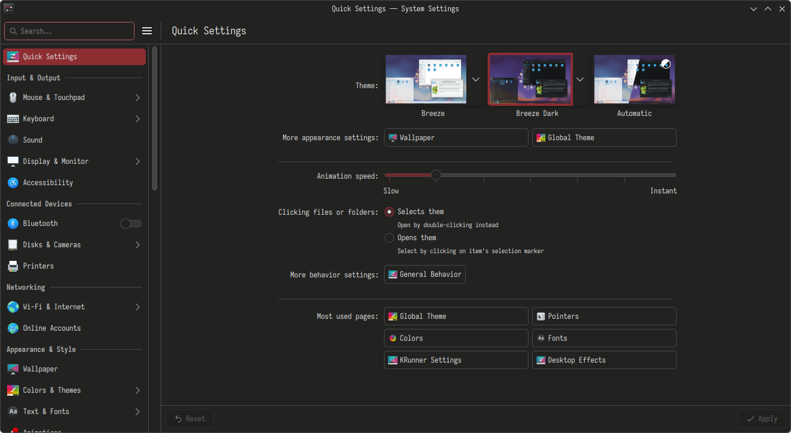
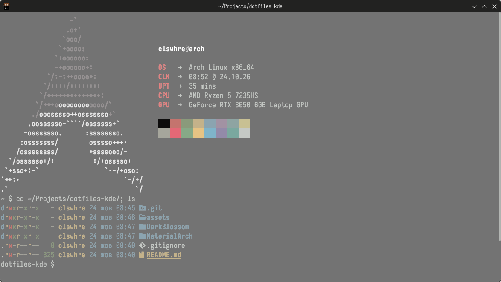
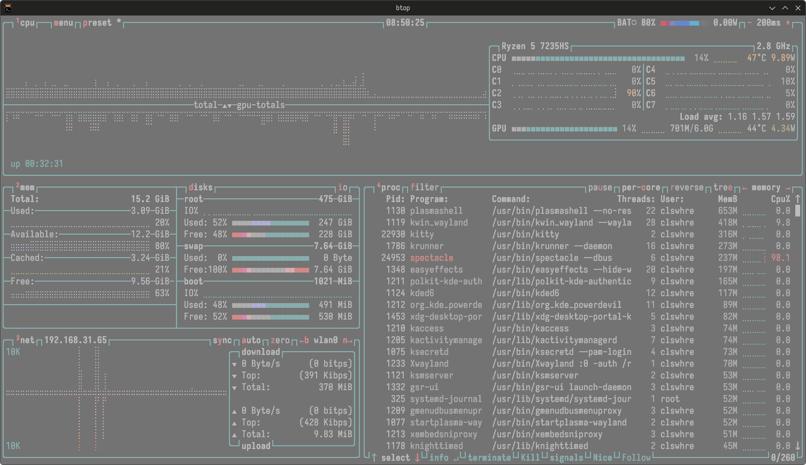

# .dotfiles

My KDE Plasma, featuring two themes: **MaterialArch** and **DarkBlossom**.

---

## 🎨 Themes

### 1. MaterialArch

#### Wallpaper


#### Desktop & Settings


#### Terminal Workflow


#### Btop


---

### 2. DarkBlossom

#### Wallpaper


#### Desktop & Settings


#### Terminal Workflow


#### Btop


---

## ⚙️ Configuration

**OS:** Arch x86_64\
**DE:** KDE Plasma 6.8.1\
**Shell:** bash 5.3.20(1)-release\
**Terminal:** Kitty 0.49.2

---

## 📂 Structure

```text
.
├── DarkBlossom
│   ├── .config
│   │   ├──.bashrc
│   │   ├──.inputrc
│   │   ├── btop
│   │   │   ├── btop.conf
│   │   │   └── themes
│   │   ├── fastfetch
│   │   │   └── config.jsonc
│   │   └── kitty
│   │       ├── fonts.conf
│   │       ├── kitty.conf
│   │       └── theme.conf
│   ├── assets
│   │   ├── btop.png
│   │   ├── kde.png
│   │   └── kitty.png
│   └── Resources
│       ├── DarkBlossom.colors
│       └── tree.jpg
├── MaterialArch
│   ├── .config
│   │   ├──.bashrc
│   │   ├──.inputrc
│   │   ├── btop
│   │   │   └── btop.conf
│   │   ├── fastfetch
│   │   │   └── config.jsonc
    │   └── kitty
│   │       └── kitty.conf
│   ├── assets
│   │   ├── btop.png
│   │   ├── kde.png
│   │   └── kitty.png
│   └── Resources
│       ├── MaterialArch_3840x2160.png
│       └── MaterialArch.colors
└── README.md
```
